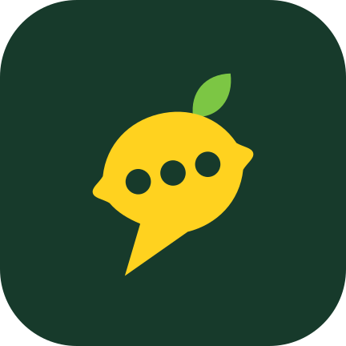
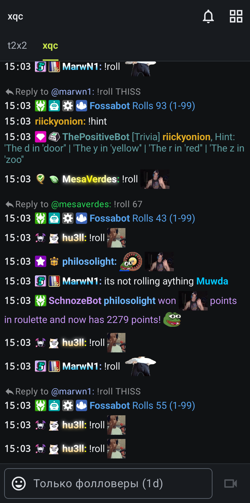
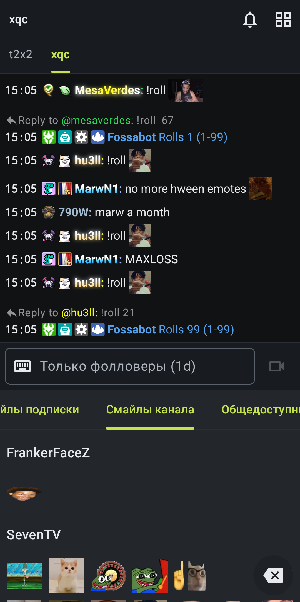
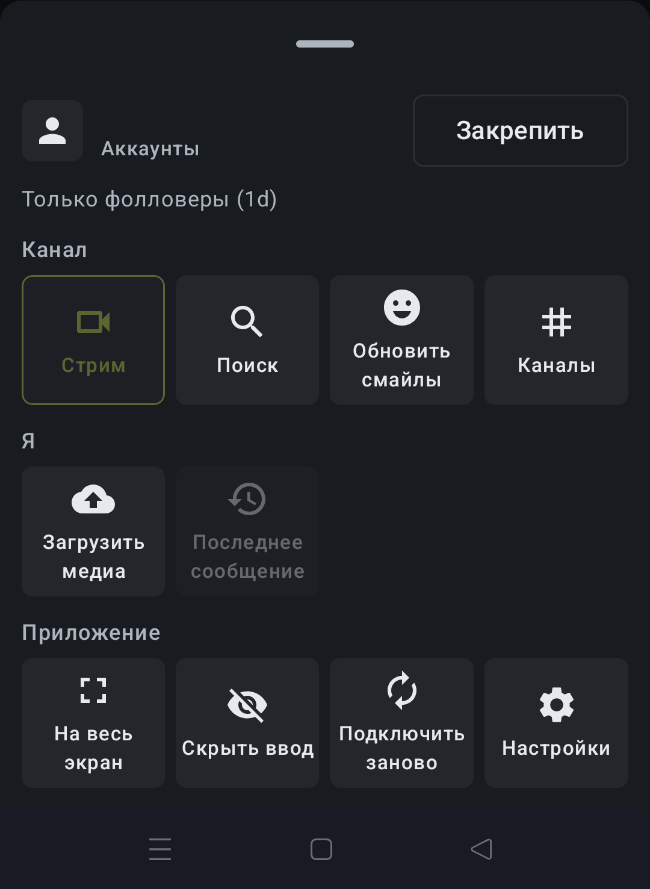

  

<h1 align="center">LemChat</h1>

  A Twitch chat app for Android with 7TV paints, third-party badges and a compact design. 
  <a href="#русский">Описание на русском</a>

  
  
  

## Features

- **7TV paints**, including animated ones and paints on @mentions
- **7TV personal emotes**, with a Personal tab in the emote picker while you have an active 7TV subscription and personal emotes
- **7TV, FrankerFaceZ and BetterTTV badges** next to Twitch badges
- **Several Twitch accounts** with quick switching
- **Chat beside the stream** in landscape, so it doesn't cover the player
- **Compact message input** and a solid top bar, with less common actions in one menu
- **Interface language setting**, English by default
- **Built-in updates**: the app offers new versions, and you can install them now or later from Settings

## Install

1. Open [Releases](https://github.com/C1trus01/LemChat/releases/latest) and download the `.apk` file.
2. Open the file and allow your browser or file manager to install apps if Android asks.

You need Android 11 or newer. LemChat isn't on Google Play, so Play Protect may show a warning. It's your choice whether to continue.

LemChat is a separate app, so it can be installed next to DankChat. Your login, channels and settings don't carry over.

## Privacy

LemChat has no servers of its own and no analytics. Crash reports stay on your phone and are only shared if you copy them yourself.

The app connects directly to the services it needs: Twitch, 7TV, FrankerFaceZ, BetterTTV, dank.chat for DankChat badges, and GitHub for update checks. Depending on your settings and what you use, it also connects to the message history service, Supinic and the media upload service.

## Credits

LemChat is based on [DankChat](https://github.com/flex3r/dankchat) by [@flex3rs](https://github.com/flex3r) and contributors, used under the [MIT License](LICENSE). Please report LemChat problems [here](https://github.com/C1trus01/LemChat/issues), not to the DankChat developers.

This repository holds releases and information about the app. The source code isn't published at the moment.

LemChat is an unofficial app, and isn't affiliated with or endorsed by Twitch, 7TV, FrankerFaceZ, BetterTTV or DankChat.

---

## Русский

LemChat — приложение для чата Twitch на Android с пеинтами 7TV, значками сторонних сервисов и компактным дизайном.

### Возможности

- **Пеинты 7TV**, в том числе анимированные и в упоминаниях
- **Персональные смайлы 7TV** и отдельная вкладка с ними, пока у тебя есть подписка 7TV и персональные смайлы
- **Значки 7TV, FrankerFaceZ и BetterTTV** рядом со значками Twitch
- **Несколько аккаунтов Twitch** с быстрым переключением
- **Чат рядом со стримом** в горизонтальном режиме, он не закрывает плеер
- **Компактное поле ввода** и сплошная верхняя панель, а редкие действия собраны в одном меню
- **Выбор языка интерфейса**, по умолчанию английский
- **Встроенные обновления**: приложение предлагает новую версию, поставить её можно сразу или позже из настроек

### Установка

1. Открой [Releases](https://github.com/C1trus01/LemChat/releases/latest) и скачай файл `.apk`.
2. Открой файл и, если Android спросит, разреши браузеру или файловому менеджеру устанавливать приложения.

Нужен Android 11 или новее. LemChat нет в Google Play, поэтому Play Protect может показать предупреждение. Продолжать или нет, решаешь ты.

LemChat — отдельное приложение, его можно поставить рядом с DankChat. Вход, каналы и настройки не переносятся.

### Конфиденциальность

У LemChat нет своих серверов и аналитики. Отчёты об ошибках остаются на телефоне, и передать их можно, только если скопировать самому.

Приложение напрямую подключается к нужным сервисам: Twitch, 7TV, FrankerFaceZ, BetterTTV, dank.chat для значков DankChat и GitHub для проверки обновлений. В зависимости от настроек и того, чем ты пользуешься, оно также подключается к сервису истории сообщений, Supinic и сервису загрузки медиа.

### Авторы

LemChat основан на [DankChat](https://github.com/flex3r/dankchat) от [@flex3rs](https://github.com/flex3r) и других участников, используется по [лицензии MIT](LICENSE). О проблемах в LemChat пиши [сюда](https://github.com/C1trus01/LemChat/issues), а не разработчикам DankChat.

В этом репозитории лежат готовые версии и информация о приложении. Исходный код пока не опубликован.

LemChat — неофициальное приложение, оно не связано с Twitch, 7TV, FrankerFaceZ, BetterTTV и DankChat и не одобрено ими.
